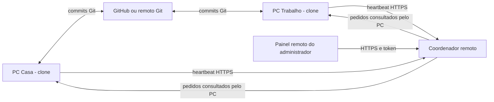
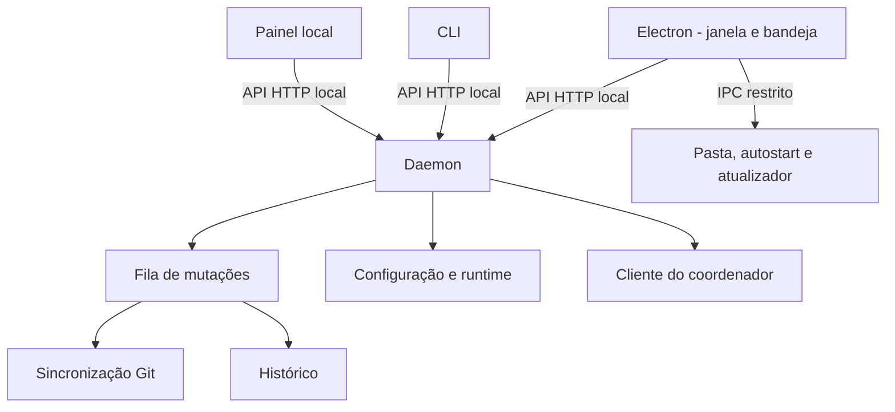

# 🏗️ Arquitetura

O serviço local é o centro de execução. Desktop e CLI usam sua API. Git move commits; o coordenador guarda dispositivos e pedidos.

## Fluxo de código e controle

## Dentro de cada PC

## Caminho de uma sincronização

1. Marcar o projeto como ocupado e obter estado/hash inicial.
2. Executar o motor Git com lock do clone.
3. Considerar checkpoint, se permitido.
4. Validar branch, operações e alterações locais.
5. Buscar o remoto; reavaliar divergência.
6. Aplicar somente fast-forward quando houver commits para receber.
7. Fazer push se autorizado e houver commits locais.
8. Registrar contagens, estado e hash final no histórico.
9. Só então liberar a ocupação do projeto.

O agendamento considera o intervalo de cada projeto; comandos e ciclos passam pela fila de mutações. O encerramento espera as operações pendentes antes de liberar a propriedade do serviço.

## Remoto e atualização

O cliente remoto consulta a cada 10 segundos, recebe pedidos permitidos e confirma resultados. A fila sobrevive à reinicialização do coordenador.

O atualizador pertence ao desktop, não ao daemon. Sua fonte é optativa e seu IPC valida o remetente. Veja [[02 Uso/Atualizacoes do aplicativo]].

Arquivos responsáveis: [[03 Engenharia/Mapa do codigo]]. Motivos das escolhas: [[03 Engenharia/Decisoes tecnicas]].

← [[00 Comece aqui]]
