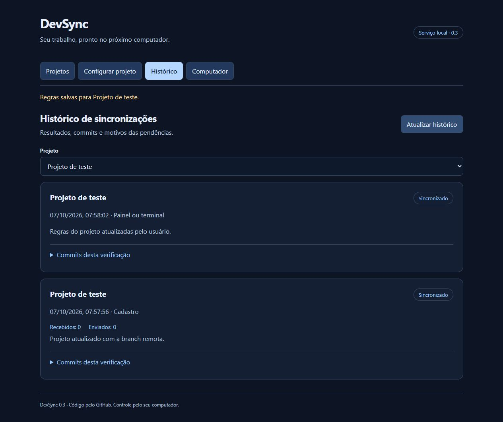

# Validação da versão 0.3

Data: 7 de outubro de 2026. Ambiente: Windows, Node.js 24.16.0, Electron 44.6.0.

## Verificado

- `node --test`: 36 testes aprovados, sem falhas ou testes ignorados. Incluem sincronização com remotos Git temporários, proteção de alterações, contagem de commits, checkpoints, regras e validação de entrada, diagnóstico, API/CLI, tokens, locks, coordenação remota e persistência.
- Histórico sobrevive à reinicialização, limita registros, filtra por projeto e omite caminhos, conteúdo e tokens.
- Checkpoints por lista de arquivos preservam alterações excluídas e arquivos novos no índice. Nomes literais Git e arquivos sensíveis têm regressões.
- Revisão de segurança encontrou e corrigiu backtracking excessivo em padrões de arquivos e liberação antecipada do lock quando uma operação de histórico falhava. Testes verificam matcher adversarial limitado, espera pelos projetos restantes e ocupação até terminar o journal.
- Atualizador testado sem rede/instaladores reais: fonte HTTPS, restrição de origem/pasta e redirecionamentos, cancelamento, checksum com falha, concorrência, download separado de instalação e parada do serviço antes de instalar. A sessão da biblioteca instalada foi conferida contra o bloqueio de requisições do Electron.
- `npm audit --omit=dev`: nenhuma vulnerabilidade reportada nas dependências de produção.
- Navegador com serviço e repositório temporários: diagnóstico pronto, cadastro, regras 45s/90s com dois padrões, histórico e filtro funcionaram; recarga preservou autenticação e regras. Tela Computador carregou. Console sem erros ou avisos. Em 390px, sem overflow horizontal; todos os campos tinham rótulos associados.
- CLI real sobre a mesma configuração isolada: `settings`, `history` e `diagnose` responderam corretamente.
- Desktop em código passou smoke isolado de serviço, bandeja e IPC, incluindo atualização.
- `npm run dist`: instalador NSIS x64 `dist/DevSync Setup 0.3.0.exe`, `.blockmap` e `latest.yml` gerados. SHA-512 do instalador corresponde ao manifesto; tamanho 111.718.632 bytes.
- Executável empacotado passou smoke com `desktopSmoke: passed`, `tray: true`, `ownedService: true`, `updateBridge: true`, `updatesSupported: true`, exit code 0. Encerramento removeu runtime e lock da configuração de teste.
- Healthcheck remoto público expõe somente liveness; autenticação continua exigida para dispositivos. Testes cobrem Host preservado por proxy, Origin inválida, limite de corpo e resposta de saúde durante upload lento.
- YAML de implantação validado e `docker compose config` aprovado com valores de teste. Docker Desktop estava sem engine Linux ativo; não foi possível construir/executar os containers neste computador.

## Limites

Não houve publicação em domínio HTTPS ou servidor de versões: é necessário informar a hospedagem/conta do usuário. A implantação está preparada, mas não está online. Não houve atualização real por download HTTPS nem execução do instalador para substituir uma instalação anterior; o fluxo foi validado por testes de controlador e IPC do executável empacotado. O binário não possui assinatura de publicador.

Não houve instalação nos dois PCs, autenticação real do GitHub, reinicialização/login do Windows para comprovar autostart, auditoria completa WCAG ou medição de desempenho. Os testes e smoke usam diretórios isolados sem modificar a configuração e os projetos reais do usuário.

## Restauração e versionamento

Antes das alterações, foi criado `.backups/devsync-before-v03-20261007-074558.zip` e registrado o commit inicial `cc397d6`, preservado na branch `backup/checkpoint-20261007-v02`. O ZIP não contém dependências nem instaladores. O projeto não possui remoto Git configurado; o código fica versionado localmente até o usuário indicar um repositório de destino.
